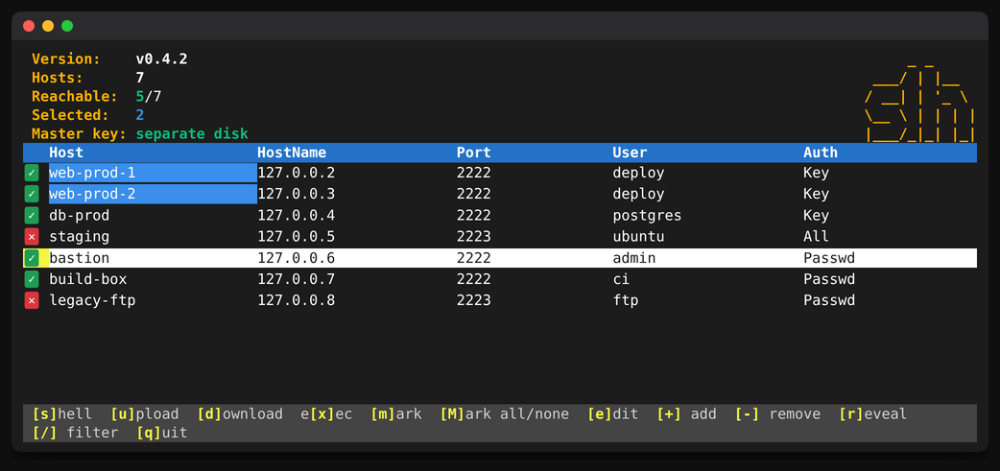
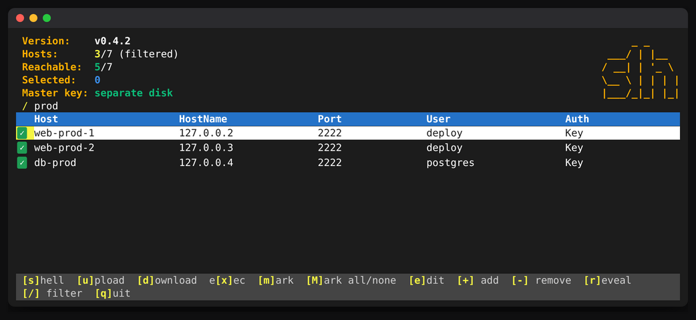
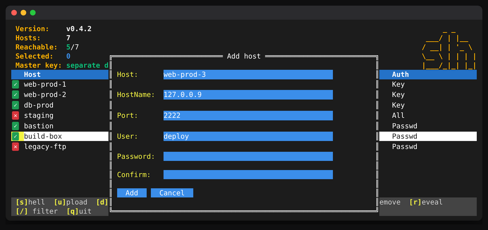
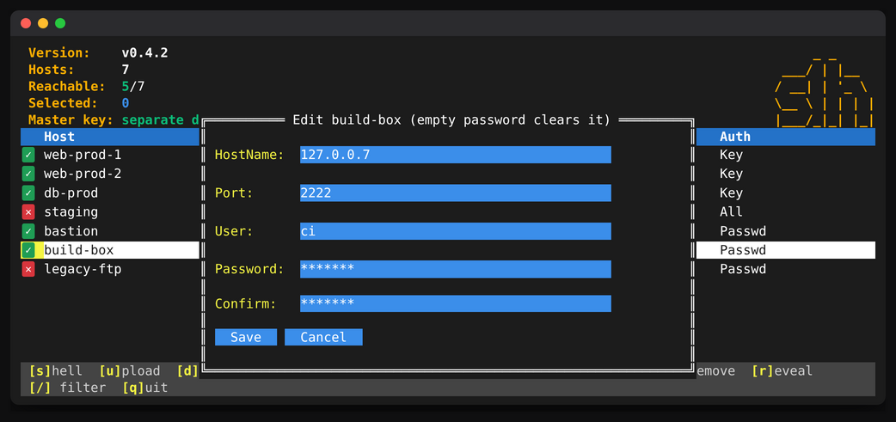
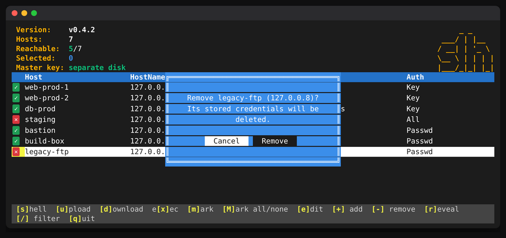

# s1h: ssh + scp + passwords manager unified in one simple CLI

`s1h` is a simple CLI/TUI tool inspired by [K9s](https://github.com/derailed/k9s).

`s1h` allows you to quickly view, connect, transfer files & execute commands into configured `ssh` host(s). Either via passwords stored & encrypted locally, or by private keys.

## Installation

From go:
```sh
# Install from Go directly:
go install github.com/noboruma/s1h/cmd/s1h@latest

```
Or from the repository:
```
# Or build from the repository source
git clone https://github.com/noboruma/s1h
cd s1h
go install ./...
```

Or download a prebuilt binary from the [latest release](https://github.com/noboruma/s1h/releases/latest), available for Linux and macOS on amd64 and arm64:

```sh
# pick one of: linux-amd64, linux-arm64, darwin-amd64, darwin-arm64
target=linux-amd64
curl -LO "https://github.com/noboruma/s1h/releases/latest/download/s1h-${target}"
curl -LO "https://github.com/noboruma/s1h/releases/latest/download/s1h-${target}.sha256"
sha256sum -c "s1h-${target}.sha256"   # on macOS: shasum -a 256 -c
chmod +x "s1h-${target}" && mv "s1h-${target}" ~/.local/bin/s1h
```

The macOS binaries are not signed: if macOS blocks a binary downloaded with a browser, run `xattr -d com.apple.quarantine s1h`.

## Tools Overview

### s1h

The `s1h` tool reads your SSH config file and lets you shell into, copy files to/from, and run commands on one or several hosts, using either a stored password or SSH keys.

#### Usage:

```sh
s1h
```

Let's take the following SSH config file (i.e. `~/.ssh/config`):
```
Host web-prod-1
  HostName 10.0.0.2
  User deploy
  IdentityFile ~/.ssh/id_ed25519

Host staging
  HostName staging.example.com
  User ubuntu
```

Running `s1h` lists every host, plus the ones added through `s1h` itself:



The first column shows whether the host's SSH port answers: a spinner while checking, then ✅ (reachable) or ❌ (not reachable with the given hostname & port). Checks run again every 2 minutes. Marked hosts are highlighted in blue.

#### Keys

| Key | Action |
| --- | --- |
| `s` | Open a shell on the selected host, using its password or SSH key |
| `u` | Upload a local file to the selected host, or to all marked hosts |
| `d` | Download a file from the selected host, or from all marked hosts (use `*` in the destination, replaced by each host name) |
| `x` | Execute a short-lived command on the selected host, or on all marked hosts |
| `m` | Mark/unmark the selected host for multi-host actions |
| `M` | Mark every reachable host in the (filtered) list, or clear all marks |
| `e` | Edit the selected host's HostName, Port, User and password |
| `+` | Add a new host |
| `-` | Remove the selected host (asks for confirmation) |
| `r` | Reveal the selected host's stored password |
| `/` | Filter the list by host or hostname |
| `Esc` | Close a popup, clear the filter, or quit |
| `q` | Quit |

#### Filtering

Press `/` and type to filter the list by host or hostname. `Enter` keeps the filter so you can act on the matching hosts (e.g. `M` to mark them all), `Esc` clears it:



#### Adding, editing and removing hosts

`+` adds a host that only lives in `s1h`'s encrypted store, without touching `~/.ssh/config`:



`e` edits a host. For hosts from `~/.ssh/config`, a changed HostName/Port/User is saved as an override in `s1h`'s store (your SSH config file is never modified). Leaving the password empty clears it:



`-` removes a host added through `s1h`, after confirmation. Hosts defined in `~/.ssh/config` have to be removed from that file.



### CLI mode

It is also possible to use `s1h` as a CLI to shell and copy files.
This approach might be more convenient if you rely on shell history to pass things around.
```
s1h cp [host1:]/path1 [host2:]/path2
s1h shell host1
s1h ip host1
```

### What about passwords?

Passwords (and hosts added or edited through `s1h`) are stored in `$HOME/.config/s1h/credentials.enc`, encrypted with AES-256-GCM using a random key kept in `$HOME/.config/s1h/master.key` (or wherever `S1H_MASTER_KEY` points). Both files are only readable by you (mode `0600`).

They can be managed from the TUI (`e`, `+`, `-`, `r`) or from the CLI below.

> [!WARNING]
> The encryption protects `credentials.enc` on its own: tampering is detected, and the file is useless without the key. But the key sits next to it, so anyone who can read your config folder (your user account, malware running as you, a backup of `~/.config`) can decrypt the passwords. For better protection, store `master.key` somewhere else, and prefer SSH keys over passwords where you can.

Files written by older versions (AES-CBC) are converted automatically the first time they are loaded. Older `s1h` binaries cannot read the converted file.

#### Keeping the master key safe

`master.key` is the only thing protecting your passwords, so treat it like a password itself:

- **Best: keep it on a removable USB stick.** Point `s1h` to it with `S1H_MASTER_KEY`, and passwords are only usable while the stick is plugged in. A stolen laptop or a leaked backup of `~/.config` then exposes nothing.
  ```sh
  # move an existing key to the stick
  mv ~/.config/s1h/master.key /media/usb/s1h-master.key
  # add to your shell profile
  export S1H_MASTER_KEY=/media/usb/s1h-master.key
  ```
  When the stick is not mounted, `s1h` still works with SSH keys, warns that stored passwords are unavailable, and refuses to create a new key, which would make the existing `credentials.enc` unreadable.
- **`s1h` checks this for you:** the TUI header shows `Master key: separate disk` when the key is on another disk than `credentials.enc`, and `⚠ same disk as credentials` otherwise. CLI commands that use the key print the same warning.
- **Keep a backup of the key** somewhere safe and separate (e.g. a second stick or a password manager). Without it, `credentials.enc` cannot be recovered.
- **Never store the key next to `credentials.enc`** in a backup, a dotfiles repository or a cloud-synced folder.

#### Usage:

```sh
s1h upsert -host=<host> [-password=<password>]
```
or
```sh
s1h upsert -host=<host>
Enter password for <host>: <terminal input>
```
This updates the stored credentials for the specified ssh host.
`s1h` comes with other password operations: `reveal` and `remove`.

Prefer the prompt over `-password=...`: passing the password as a flag leaves it in your shell history.

It is also possible to extend SSH config and add completely new entries or override existing hosts by passing a hostname, such as:
```sh
s1h upsert -host=<host> [-password=<password>] -hostname=toto.io [-user=root] [-port=22]
```

#### Example:

```
s1h upsert -host=remote-vm -password=mySecureP@ss
# Output: Credentials updated.

s1h remove -host=remote-vm
# Output: Credentials removed.
```

---

## License

This project is licensed under the MIT License.

## Contributing

Pull requests are welcome! Feel free to submit issues or suggestions.

---

**Author:** Thomas Legris

